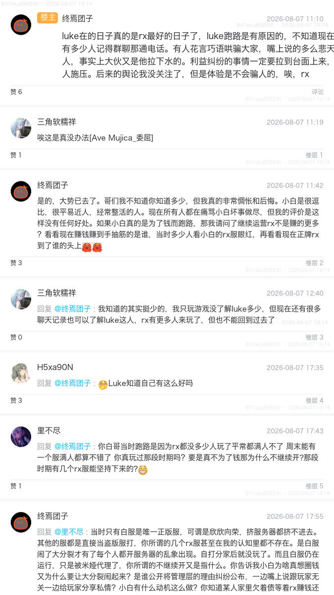

# bili-reply-capture

将 Bilibili 评论区某个「神评」及其全部楼层回复抓取下来，渲染成卡片图片并合并为一张长图，方便存档、分享或做回顾。

## 功能特性

- 🖼️ 抓取指定评论（根评论）及其**全部楼层回复**
- 🎴 每条评论渲染为独立卡片：头像、昵称、时间、点赞数、表情包
- 🧩 支持 emoji 表情 / 图片表情展示，自动按字符宽度换行
- 📜 普通模式：全部楼层合并成一张完整长图
- 🔄 实时模式（`--live`）：记录已截取楼层，只截新增楼层，并自动生成「前情提要」卡片
- 💧 可选水印（视频 BV 号 + 截图时间）
- 🖊️ 输出评论文字存档 `comment_info.txt`

## 环境要求

- Python >= 3.14（使用 `uv` 管理）
- 中文字体：macOS 内置苹方/黑体，Windows/Linux 会自动尝试常见中文字体

## 安装

```bash
git clone https://github.com/bananaxiao2333/bili-reply-capture.git
cd bili-reply-capture
uv sync
```

或使用 pip：

```bash
pip install -e .
```

## 使用方法

### 获取评论链接

打开 B 站视频评论区，在目标评论上点击「回复」或直接复制该评论的时间戳链接，链接形如：

```
https://www.bilibili.com/video/BV1xxxxx/#reply1234567890
```

`#reply<id>` 即为根评论锚点。

### 普通模式（完整长图）

```bash
uv run python main.py "https://www.bilibili.com/video/BV1xxxxx/#reply1234567890"
```

### 实时模式（只截新增楼层）

```bash
uv run python main.py --live "https://www.bilibili.com/video/BV1xxxxx/#reply1234567890"
```

多次运行会读取 `out/state.json`，仅渲染新增楼层，并在长图顶部插入「前情提要」卡片。

### 其他参数

| 参数 | 说明 |
| --- | --- |
| `--bvid` | 指定 BV 号（视频地址不包含锚点时使用） |
| `--rpid` | 指定评论 ID（配合 `--bvid` 使用） |
| `-o, --out` | 输出目录，默认 `out/` |
| `--no-avatar` | 不下载头像（离线/加速） |
| `--no-watermark` | 不添加水印 |

## 输出

```
out/
├── comment_info.txt      # 评论文字存档
├── merged_comments.png   # 普通模式长图
├── merged_live.png       # 实时模式长图（含前情提要）
├── state.json            # 实时模式状态记录
└── floors/               # 单条评论卡片
    ├── 000.png
    └── ...
```

## 示例

> 普通模式效果：根评论「神评」+ 全部楼层回复，合并为一张长图，可直接保存或发动态。



## 免责声明

本项目仅用于个人学习与存档用途，请遵守 Bilibili 用户协议与相关法律法规，勿用于商业或恶意用途。接口字段可能随 B 站改版而变化，如遇失效请提 [Issue](https://github.com/bananaxiao2333/bili-reply-capture/issues)。

## License

[MIT](LICENSE)
